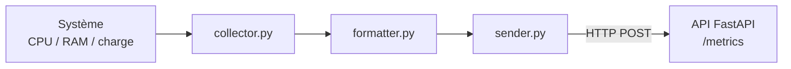
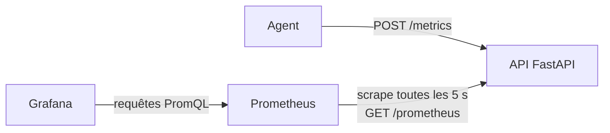
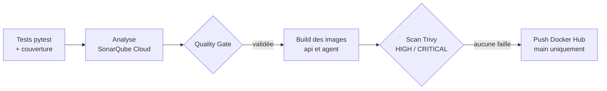

# System Metrics Agent

> **TP DevOps : conteneuriser et automatiser le déploiement d'un agent de métriques**
>
> **Étudiant :** Le Bonheur BAMBO\
> **Classe :** INGC2 (Ingénieur de Conception, 2e année)\
> **Établissement :** Institut Africain d'Informatique (IAI), Gabon\
> **Année académique :** 2026-2027

[](https://github.com/Lebonheur2370/system_metrics_agent/actions/workflows/ci-cd.yml)
[](https://sonarcloud.io/summary/new_code?id=Lebonheur2370_system_metrics_agent)
[](https://sonarcloud.io/summary/new_code?id=Lebonheur2370_system_metrics_agent)

Agent Python modulaire qui collecte les métriques système (CPU, RAM, charge) et les transmet en temps réel à une API FastAPI ou à un webhook externe. Le projet est conteneurisé et livré par une chaîne DevSecOps complète : tests, analyse de qualité, scan de vulnérabilités et publication automatique sur Docker Hub.

| Ressource | Lien |
|---|---|
| Pipeline CI/CD | [GitHub Actions](https://github.com/Lebonheur2370/system_metrics_agent/actions) |
| Qualité du code | [SonarQube Cloud](https://sonarcloud.io/summary/new_code?id=Lebonheur2370_system_metrics_agent) |
| Image de l'API | [lebonheurbambo/metrics-api](https://hub.docker.com/r/lebonheurbambo/metrics-api) |
| Image de l'agent | [lebonheurbambo/metrics-agent](https://hub.docker.com/r/lebonheurbambo/metrics-agent) |

---

## Rapport du TP DevOps

### Choix techniques

- **Image de base `python:3.12.15-slim`** : Debian minimale, dernière version corrigée de Python 3.12, tag figé pour garantir un build reproductible. Alpine a été écartée car sa libc `musl` oblige à compiler certains paquets comme `psutil`.
- **Build multi-stage** : les dépendances sont installées dans un environnement virtuel à l'étape *builder* ; seul cet environnement est copié dans l'image finale.
- **Sécurité** : utilisateur non-root `app`, aucun secret dans l'image (`.env` exclu par `.dockerignore`), dépendances de production séparées de celles de développement.
- **Prêt pour la production** : uvicorn lancé sans `--reload` sur `0.0.0.0`, `HEALTHCHECK` sur `/health` écrit en Python (l'image slim ne contient pas `curl`).
- **Agent** : ajout du paquet `procps`, qui fournit la commande `uptime` absente de l'image slim.
- **Docker Compose** : l'agent joint l'API par son nom de service (`http://api:8000/metrics`) et ne démarre qu'une fois l'API saine (`condition: service_healthy`).
- **Pipeline** : actions GitHub épinglées par SHA de commit (après la compromission de `trivy-action` en mars 2026), permissions minimales, push limité à la branche `main`, cache Docker GitHub Actions.

### Résultats

| Indicateur | Valeur |
|---|---|
| Image de base `python:3.12.15-slim` | 177 Mo |
| Image `metrics-api` | 257 Mo |
| Image `metrics-agent` | 259 Mo (+2 Mo pour `procps`) |
| Tests | 24 tests réussis |
| Couverture (SonarQube Cloud) | 83,5 % |
| Quality Gate | Validée |
| Vulnérabilités HIGH / CRITICAL corrigeables | 0 |

### Bonus : supervision

L'API expose ses métriques au format Prometheus sur `/prometheus`. Prometheus les collecte toutes les 5 secondes et Grafana les affiche dans un tableau de bord provisionné automatiquement. Voir la section [Supervision avec Prometheus et Grafana](#supervision-avec-prometheus-et-grafana).

### Agent conteneurisé et machine hôte

Dans un conteneur, l'agent mesure son environnement isolé et non la machine hôte : le hostname devient l'identifiant du conteneur et la mémoire totale passe de 16,9 Go (Windows) à 8,2 Go (machine virtuelle WSL2 de Docker Desktop). Pour superviser un vrai serveur, il faudrait exécuter l'agent directement sur l'hôte, ou donner au conteneur l'accès aux informations de l'hôte (`pid: host`, montage de `/proc` en lecture seule), au prix d'une isolation réduite.

### Preuve que les contrôles fonctionnent

L'image de base a été volontairement remplacée par `python:3.12.7-slim` (Debian 12.8). Trivy a détecté **52 vulnérabilités corrigeables (45 HIGH, 7 CRITICAL)** dans les paquets système : le job de l'API a échoué et le push vers Docker Hub a été sauté. L'image de l'agent, inchangée, a été publiée normalement grâce à `fail-fast: false`. Le retour à la version 3.12.15 par `git revert` a rétabli un pipeline vert.

### Difficultés rencontrées

- **Tests dépendants du système** : deux tests du collecteur échouaient sous Windows, car ils simulaient `uptime` sans simuler le système d'exploitation. Corrigé par un `patch` de `platform.system`.
- **Tests manquants** : le fichier `test_api.py` annoncé n'existait pas. Ajout des tests de l'API, de la configuration et de l'agent, portant la couverture à 83,5 %.
- **Paquet `httpx2`** : d'abord pris pour une faute de frappe, il s'agit en réalité du paquet recommandé par Starlette pour son client de test, comme l'a révélé un avertissement de dépréciation.
- **Secrets et permissions** : un premier pipeline a échoué faute de secrets GitHub, puis le push a été refusé (`insufficient scopes`) à cause d'un token Docker Hub en lecture seule.
- **SonarQube Cloud** : l'analyse automatique a dû être désactivée, car elle entre en conflit avec l'analyse lancée par le pipeline.

---

## Fonctionnalités

- Collecte du pourcentage CPU et du nombre de cœurs logiques avec `psutil`.
- Collecte de la mémoire RAM totale, utilisée et disponible.
- Collecte de la charge système via la commande `uptime`, exécutée avec `subprocess`.
- Envoi HTTP des métriques au format JSON, à intervalle régulier.
- API de réception FastAPI avec stockage en mémoire.
- Exposition des métriques au format Prometheus et tableau de bord Grafana.
- Configuration externe par variables d'environnement ou fichier `.env`.
- Gestion des erreurs réseau, des timeouts et des erreurs de collecte.

## Architecture

```text
system_metrics_agent/
├── .github/
│   └── workflows/
│       └── ci-cd.yml            # Pipeline CI/CD
├── app/
│   ├── __init__.py
│   ├── agent.py                 # Orchestration : collecte, formatage, envoi
│   ├── api.py                   # API de réception FastAPI
│   ├── collector.py             # Collecte des métriques
│   ├── config.py                # Chargement de la configuration
│   ├── formatter.py             # Normalisation du payload
│   ├── sender.py                # Envoi HTTP
│   └── tests/                   # Tests unitaires pytest
├── monitoring/
│   ├── prometheus/
│   │   └── prometheus.yml       # Configuration de la collecte
│   └── grafana/
│       ├── dashboards/          # Tableau de bord JSON
│       └── provisioning/        # Source de données et chargement automatique
├── .dockerignore
├── .env.example                 # Modèle de configuration
├── Dockerfile.agent
├── Dockerfile.api
├── docker-compose.yml
├── requirements.txt             # Dépendances de production
├── requirements-dev.txt         # Dépendances de test et de qualité
└── sonar-project.properties
```

Le flux de données suit les modules dans l'ordre :



## Démarrage rapide avec Docker Compose

Prérequis : Docker et Docker Compose.

```bash
cp .env.example .env
docker compose up --build
```

Sous Windows, copier manuellement `.env.example` en `.env`.

L'API est disponible sur `http://localhost:8000`. Pour vérifier que l'agent conteneurisé envoie bien ses métriques :

```bash
curl http://localhost:8000/metrics/latest
```

Pour tout arrêter :

```bash
docker compose down
```

## Installation locale

Prérequis : Python 3.12.

```bash
python -m venv .venv
```

Activer l'environnement virtuel :

| Système | Commande |
|---|---|
| Linux / macOS | `source .venv/bin/activate` |
| Windows (PowerShell) | `.venv\Scripts\Activate.ps1` |
| Windows (cmd) | `.venv\Scripts\activate.bat` |

Installer les dépendances et créer la configuration :

```bash
pip install -r requirements-dev.txt
cp .env.example .env
```

Démarrer l'API, puis l'agent dans un second terminal :

```bash
uvicorn app.api:app --reload
python -m app.agent
```

La documentation interactive de l'API est disponible sur `http://127.0.0.1:8000/docs`.

> Sous Windows, la commande `uptime` n'existe pas : les valeurs de charge (`load_1m`, `load_5m`, `load_15m`) valent `null`. Elles sont renseignées sous Linux et dans le conteneur.

## Configuration

| Variable | Description | Valeur par défaut |
|---|---|---|
| `METRICS_ENDPOINT` | URL de l'API ou du webhook qui reçoit les métriques | `http://127.0.0.1:8000/metrics` |
| `COLLECTION_INTERVAL` | Intervalle entre deux collectes, en secondes | `5` |
| `REQUEST_TIMEOUT` | Timeout des requêtes HTTP, en secondes | `5` |

Avec Docker Compose, `METRICS_ENDPOINT` est automatiquement remplacé par `http://api:8000/metrics`.

## API

| Méthode | Route | Description | Réponse |
|---|---|---|---|
| `GET` | `/health` | État de l'API | `200` `{"status": "ok"}` |
| `POST` | `/metrics` | Réception d'une métrique | `201`, ou `422` si le payload est invalide |
| `GET` | `/metrics` | Liste de toutes les métriques reçues | `200` |
| `GET` | `/metrics/latest` | Dernière métrique reçue | `200`, ou `404` si aucune métrique |
| `GET` | `/prometheus` | Métriques au format Prometheus | `200` (`text/plain`) |

Exemple de métrique envoyée par l'agent :

```json
{
  "agent": "system-metrics-agent",
  "event_type": "system_metrics",
  "data": {
    "timestamp": "2026-10-12T23:44:49.798982+00:00",
    "hostname": "server-01",
    "cpu": { "percent": 23.4, "logical_cores": 4 },
    "memory": {
      "total_bytes": 8230522880,
      "available_bytes": 7413239808,
      "used_bytes": 817283072,
      "percent": 9.9
    },
    "system": { "load_1m": 1.41, "load_5m": 0.53, "load_15m": 0.25 }
  }
}
```

## Supervision avec Prometheus et Grafana

La supervision est déclarée dans `docker-compose.yml` sous le profil `monitoring` : un simple `docker compose up` ne lance que l'API et l'agent, comme avant.

```bash
docker compose --profile monitoring up --build
```

| Service | Adresse | Rôle |
|---|---|---|
| Prometheus | `http://localhost:9090` | Collecte et stockage des métriques (7 jours) |
| Grafana | `http://localhost:3000` | Tableau de bord *System Metrics Agent* |

Les identifiants de Grafana sont lus dans `.env` (`GRAFANA_ADMIN_USER`, `GRAFANA_ADMIN_PASSWORD`). Le démarrage échoue volontairement si le mot de passe n'est pas défini.



### Métriques exposées

Toutes les séries portent l'étiquette `hostname`, ce qui permet de suivre plusieurs agents.

| Métrique | Type | Description |
|---|---|---|
| `agent_cpu_percent` | gauge | Utilisation CPU (%) |
| `agent_cpu_logical_cores` | gauge | Nombre de cœurs logiques |
| `agent_memory_percent` | gauge | Mémoire utilisée (%) |
| `agent_memory_used_bytes` | gauge | Mémoire utilisée (octets) |
| `agent_memory_total_bytes` | gauge | Mémoire totale (octets) |
| `agent_load_1m`, `agent_load_5m`, `agent_load_15m` | gauge | Charge système (absente sous Windows) |
| `agent_metrics_received_total` | counter | Nombre de métriques reçues |
| `agent_last_received_timestamp_seconds` | gauge | Horodatage du dernier envoi |

### Tableau de bord

Le tableau de bord est créé automatiquement au démarrage (provisioning) et s'ouvre en page d'accueil. Il affiche le temps écoulé depuis la dernière métrique (rouge au-delà de 30 secondes : l'agent ne répond plus), le CPU, la mémoire, le débit de métriques reçues, ainsi que les courbes d'utilisation CPU, mémoire et de charge système. Un filtre *Machine* permet de sélectionner un ou plusieurs agents.

## Tests

```bash
pytest -q
pytest --cov=app --cov-report=term-missing
```

Les tests se trouvent dans `app/tests/`. Ils simulent le système, la commande `uptime` et le réseau : ils s'exécutent de la même façon sous Windows, Linux et dans le pipeline.

## Pipeline CI/CD

Le workflow `.github/workflows/ci-cd.yml` se déclenche sur chaque `push` et chaque pull request vers `main`.



- **Job `test`** : tests avec couverture, analyse SonarQube Cloud, échec si la Quality Gate n'est pas validée.
- **Job `build-scan-push`** : exécuté seulement si le job `test` réussit, en matrice pour l'API et l'agent. L'image est construite localement, scannée par Trivy, puis publiée avec deux tags (SHA du commit et `latest`), uniquement sur `main` et jamais depuis une pull request.

Secrets requis dans *Settings > Secrets and variables > Actions* : `DOCKERHUB_USERNAME`, `DOCKERHUB_TOKEN`, `SONAR_TOKEN`, `SONAR_HOST_URL`.

## Robustesse

Le projet gère notamment :

- les erreurs d'exécution de `subprocess` et l'absence de la commande `uptime` ;
- les timeouts et les erreurs de connexion HTTP ;
- les réponses HTTP en erreur ;
- les configurations invalides ;
- les payloads incomplets ou invalides ;
- l'absence de métriques dans l'API.